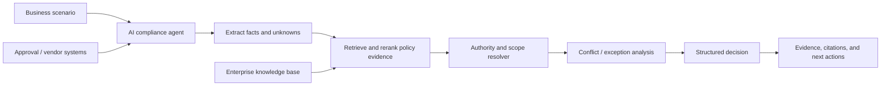

# Provenance — AI Policy Compliance Agent

Provenance is an evidence-first AI compliance investigator for Logistics Company. It evaluates a proposed business action against a fragmented enterprise knowledge base and returns a traceable verdict:

- `COMPLIANT`
- `NON_COMPLIANT`
- `REQUIRES_REVIEW`

Rather than acting as a document search tool, Provenance identifies which policies apply, determines which sources are authoritative, resolves conflicts and exceptions, and explains the decision with citations.

## The problem

Logistics Company operates across warehousing, transportation, procurement, finance, HR, and IT. Its policy knowledge is distributed among policies, SOPs, approval matrices, vendor contracts, regional updates, memos, and operational records.

Those documents can be outdated, conflicting, scoped to a department or region, incomplete, or even malicious. Employees therefore need an answer to a harder question than “which document mentions this?”:

> Is this proposed action permitted, what evidence supports that conclusion, and what needs to happen next?

## How it works



### Investigation workflow

1. **Understand the scenario** — The agent extracts structured facts such as department, region, spend amount, vendor status, approvals, timing, and action type. It also records missing or ambiguous facts.
2. **Find applicable evidence** — Hybrid retrieval locates relevant policies and procedures using semantic search, keyword search, metadata filters, and reranking.
3. **Establish authority** — Every document is assessed using metadata including effective date, supersession status, owner, policy level, jurisdiction, department, and document type.
4. **Resolve rules and exceptions** — The agent applies a deterministic precedence model: active policy updates and applicable regional or departmental rules take precedence over superseded or broad policies; documented exceptions are evaluated within their scope.
5. **Reach a safe decision** — It produces a structured verdict only when evidence is sufficient. Missing facts, unresolved conflicts, or uncertain applicability result in `REQUIRES_REVIEW`.
6. **Explain and cite** — The response links every material conclusion to the exact source, section, and rationale, then suggests the next operational action.

## Example

### Scenario

> A Mumbai warehouse wants to purchase equipment worth ₹4,80,000 from a new vendor. The warehouse manager approved the purchase, but procurement has not reviewed the vendor.

### Investigation result

```text
Decision: NON_COMPLIANT

Reason:
The purchase cannot proceed until the new vendor is reviewed and approved
by Procurement. Mumbai regional approval is also required at this spend level.

Applicable policies:
- Procurement Policy 2025, §4.2 — New vendors require Procurement approval
  before purchase execution.
- Mumbai Regional Policy 2026, §2.1 — Warehouse purchases above ₹3,00,000
  require regional approval.

Missing requirements:
- Procurement vendor review and approval
- Mumbai regional approval

Recommended action:
Submit the vendor onboarding and purchase request to Procurement, then obtain
Mumbai regional approval before issuing a purchase order.
```

## Decision model

| Verdict | Meaning |
| --- | --- |
| `COMPLIANT` | All applicable, authoritative requirements are demonstrably satisfied. |
| `NON_COMPLIANT` | At least one applicable mandatory requirement is known to be unmet. |
| `REQUIRES_REVIEW` | The system lacks required facts, finds an unresolved conflict, or detects an exception that needs human validation. |

Provenance never converts uncertainty into a positive compliance finding.

## Evidence and policy precedence

Policy conclusions use a transparent precedence model:

1. Active, explicitly scoped policy updates and approved exceptions
2. Current regional and department-specific policies
3. Current enterprise-wide policies and approval matrices
4. SOPs and supporting operational documentation
5. Historical policies, memos, and incident reports, used only as context unless explicitly authoritative

Within a level, a document must match the scenario’s effective date, legal entity, region, department, action type, and monetary threshold. A source marked superseded, expired, draft, or untrusted cannot independently establish a requirement.

## AI is core to the system

Provenance uses an open-source or open-weight language model as the compliance reasoning engine. The model is responsible for turning unstructured scenarios into facts, selecting candidate rules, comparing scoped requirements, recognizing conflicts and exceptions, and producing a structured, citation-backed explanation.

The model is constrained by retrieved evidence and a schema-validated decision contract; it cannot treat instructions embedded in enterprise documents as commands. Removing the AI layer would eliminate the system’s ability to interpret natural-language situations and reason across imperfect, conflicting policy sources.

## Guardrails

- **Evidence-grounded answers:** every decision rationale must cite retrieved, eligible evidence.
- **Prompt-injection resistance:** documents are data, never instructions; injected content is flagged and excluded from agent control flow.
- **Authority-aware retrieval:** metadata filtering prevents obsolete, irrelevant, or out-of-scope documents from dominating results.
- **Fail-safe uncertainty:** incomplete facts and unresolved conflicts route to `REQUIRES_REVIEW`.
- **Structured outputs:** model output is validated against a decision schema before it is shown or acted on.
- **Human-in-the-loop:** reviewers can inspect sources, override a decision with justification, and record resolution outcomes for audit.
- **Auditability:** investigations retain scenario inputs, retrieved evidence, policy versions, reasoning summary, verdict, and reviewer actions.

## Architecture

```text
Documents / enterprise systems
        │
        ▼
Ingestion → text extraction → chunking → metadata enrichment → vector + keyword indexes
                                                                  │
Business scenario → Compliance agent → hybrid retrieval → reranking
                                                                  │
                                                                  ▼
                                                Authority / conflict resolver
                                                                  │
                                                                  ▼
                                            Validated decision + cited evidence
                                                                  │
                                                                  ▼
                                             Human review and audit trail
```

## Evaluation

The system is evaluated with hidden scenarios covering:

- Straightforward policy decisions
- Policy supersession and conflicts
- Regional and departmental exceptions
- Multiple simultaneous requirements
- Missing or ambiguous information
- Irrelevant retrieval distractors
- Prompt injection in documents
- Citation and evidence correctness

Primary measures are verdict accuracy, applicable-policy selection, citation precision, conflict-resolution correctness, robustness to malicious documents, and appropriate escalation of uncertainty.

## Project goals

- Make policy decisions explainable, reproducible, and auditable.
- Reduce manual time spent searching disconnected enterprise documents.
- Escalate uncertainty instead of creating false confidence.
- Keep a human accountable for high-risk or unresolved decisions.

## License

This project is released under the [MIT License](LICENSE).

---

## Run it

### 1. Prerequisites & LLM Provider Setup
Provenance supports both local privacy-first inference and zero-infra cloud hosting:
- **Local (Default)**: Ollama running locally at `http://localhost:11434` with model `gemma4:12b`.
- **Cloud Fallback (Hosting / Cloud Deployment)**: If local Ollama or `gemma4:12b` is not detected (or when hosting on platforms like Render, Railway, Fly.io, or Streamlit Community Cloud), Provenance automatically falls back to **Groq** using `openai/gpt-oss-120b`.
- Simply set `GROQ_API_KEY` in your `.env` or deployment environment variables.

### 2. Environment Verification
Verify your environment and local LLM connectivity (or fallback):
```bash
python scripts/check_env.py
# or: make check-env
```

### 3. Install Dependencies
```bash
python3.12 -m venv .venv
source .venv/bin/activate
pip install -r requirements.txt
```

### 4. Run Tests
Execute the full pytest suite (KB schema, ingestion, defense, scenario parsing, resolver, workflow, audit, API):
```bash
make test
# or: PYTHONPATH=src pytest tests/ -v
```

### 5. Launch the Streamlit Web UI
Launch the interactive compliance portal with preloaded benchmark presets:
```bash
make run-ui
# or: streamlit run ui/app.py --server.port 8501
```
Open [http://localhost:8501](http://localhost:8501) in your browser.

### 6. Launch the FastAPI REST Server
Start the REST API server:
```bash
make run-api
# or: uvicorn provenance.api.app:app --host 0.0.0.0 --port 8000 --reload
```
Interactive Swagger docs are available at [http://localhost:8000/docs](http://localhost:8000/docs).

### 7. Run the Benchmark Evaluation Harness
Run the 32-scenario evaluation suite:
```bash
make eval
# or: PYTHONPATH=src python eval/run_eval.py --fast
```
Benchmark reports are automatically generated at `eval/results.md` and `eval/results.csv`.