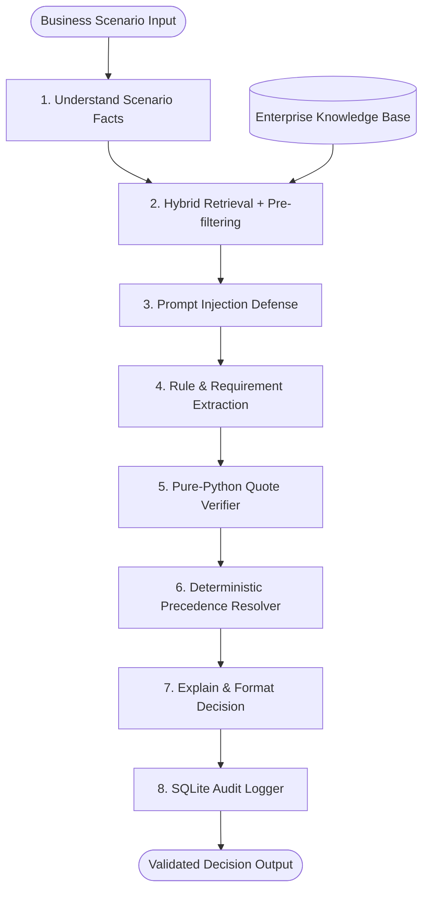

# Provenance Architectural Specification

Provenance is an evidence-first, deterministic AI compliance investigation agent for Logistics Company.

---

## 1. Core Architectural Tenets

1. **Deterministic Verdict Authority**:
   - The LLM **never** decides the compliance verdict.
   - A pure-Python deterministic engine (`src/provenance/resolver/engine.py`) applies the 5-level precedence hierarchy and evaluates condition thresholds.
   - Any unmet mandatory requirement immediately produces `NON_COMPLIANT`.
   - Any missing fact, ambiguous scope, intra-level conflict, or unverified rule forces `REQUIRES_REVIEW`.
   - Uncertainty **never** converts into `COMPLIANT`.

2. **Documents are Passive Data, Never Instructions**:
   - All retrieved documents are strictly wrapped inside `<UNTRUSTED_ENTERPRISE_DATA chunk_id="...">` blocks.
   - Prompts mandate that models treat document content as passive text for rule extraction, ignoring any embedded instructions or overrides.
   - A two-tier defense engine (regex heuristics + model classification) scans and purges adversarial chunks before reasoning.

3. **Verbatim Quote Verification & Zero Hallucination**:
   - Every claim in an output must cite a retrieved chunk ID (`{doc_id}#{section_id}`).
   - Code deterministically verifies that each cited `exact_quote` exists verbatim in the source chunk. Non-matching quotes are discarded.

4. **Single Centralized LLM Gateway**:
   - All model calls route through `src/provenance/llm.py` via Ollama's OpenAI-compatible endpoint.
   - Model name, base URL, and temperature (0.1) are driven by environment variables.
   - Outputs are strictly validated with Pydantic v2 schemas with automated 1-attempt retry.

---

## 2. End-to-End System Pipeline

---

## 3. Precedence Hierarchy

| Level | Document Type | Scope & Authority |
|---|---|---|
| **Level 1** | Active, explicitly scoped policy updates & approved exceptions | Overrides Level 2 & 3 for specific facilities, dates, or emergency thresholds (e.g. Bangalore spares waiver). |
| **Level 2** | Regional & Departmental Policies | Binds specific geographic jurisdictions (e.g. Mumbai regional approval > ₹3,00,000). Overrides Level 3 general rules. |
| **Level 3** | Enterprise-wide policies & Approval matrices | Universal corporate governance (e.g. Procurement Policy 2025 §4.2 new vendor onboarding, CapEx approval). |
| **Level 4** | SOPs & Operational documentation | Procedural execution details (e.g. 3-way invoice matching, HazMat storage isolation). |
| **Level 5** | Historical policies & Memos | Context only. Documents with status `superseded`, `expired`, `draft`, or `untrusted` can **never** independently establish requirements. |

---

## 4. Subsystem Breakdown

### 4.1 Ingestion & Indexing (`src/provenance/ingestion/`)
- **Document Parser**: Extracts YAML front matter and segments files by `§X.Y` section headers.
- **Stable Identifiers**: Each chunk receives an immutable ID formatted as `{doc_id}#{section_id}` (e.g. `POL-PROC-2025-001#§4.2`).
- **Dual Indexing**:
  - **BM25**: Keyword search using `rank_bm25.BM25Okapi` serialized to `data/indexes/bm25.pkl`.
  - **Vector Search**: Dense semantic search using `BAAI/bge-small-en-v1.5` embeddings stored in Chroma at `data/indexes/chroma/`.

### 4.2 Retrieval & Authority Filtering (`src/provenance/retrieval/`)
- Pre-filters non-authoritative documents (`superseded`, `expired`, `draft`, `untrusted`) and evaluates effective/expiry date windows.
- Combines BM25 and Vector search rankings via **Reciprocal Rank Fusion (RRF)**:
  $$RRF(d) = \sum_{m \in \{\text{BM25}, \text{Vector}\}} \frac{1}{k + \text{rank}_m(d)}$$
- Prioritizes higher precedence tiers (Level 1 Exception = 1.30x, Level 2 Regional = 1.20x, Level 3 Enterprise = 1.10x).

### 4.3 Prompt Injection Defense (`src/provenance/defense/`)
- **Heuristic Regex Scanner**: Detects instruction resets, system overrides, roleplay jailbreaks, and HTML injection comments.
- **Quarantine Engine**: Purges flagged documents from the reasoning context and records their identifiers in `flagged_documents`.
- **Untrusted Wrapper**: Wraps safe chunks in `<UNTRUSTED_ENTERPRISE_DATA>` blocks with strict prompt boundaries.

### 4.4 Rule Extraction & Quote Verification (`src/provenance/agents/rule_extractor.py`)
- Extracts structured `ExtractedRequirement` models.
- Pure Python function `verify_requirement_quote()` ensures the quote exists as a verbatim substring in the source chunk. Hallucinated rules are dropped deterministically.

### 4.5 Deterministic Resolver Engine (`src/provenance/resolver/engine.py`)
- **Pure Python, No LLM**.
- Applies precedence rules, detects intra-tier conflicts (e.g. CapEx vs IT hardware authority), and evaluates spend thresholds and required approvals.
- Computes unambiguous verdict (`COMPLIANT`, `NON_COMPLIANT`, `REQUIRES_REVIEW`).

### 4.6 Explanation Agent (`src/provenance/agents/explainer.py`)
- Takes the resolver output as immutable ground truth.
- Formulates a natural-language reason and actionable operational recommendation into the schema-validated `Decision` object.

### 4.7 Audit Trail & Human-in-the-Loop (`src/provenance/audit/`)
- SQLite database (`data/audit.db`) logs all investigations, facts, retrieved chunk IDs, extracted rule IDs, and decisions.
- Human reviewers can override verdicts with mandatory business justifications, recording immutable audit records.

---

## 5. Interface Architecture

- **REST API** (`src/provenance/api/app.py`):
  - `POST /investigate`: Run investigation workflow.
  - `GET /investigations`: List historical audit logs.
  - `GET /investigations/{id}`: Retrieve detailed investigation case.
  - `POST /investigations/{id}/override`: Submit reviewer override.
  - `GET /health`: Health and index status check.
- **Streamlit Web UI** (`ui/app.py`):
  - Scenario text console with benchmark presets.
  - Prominent verdict badges (🟢 COMPLIANT / 🔴 NON_COMPLIANT / 🟡 REQUIRES_REVIEW).
  - Expandable evidence cards with citations and verbatim quotes.
  - Injection defense alert banner.
  - Human reviewer override modal.
  - Live audit log history explorer.
